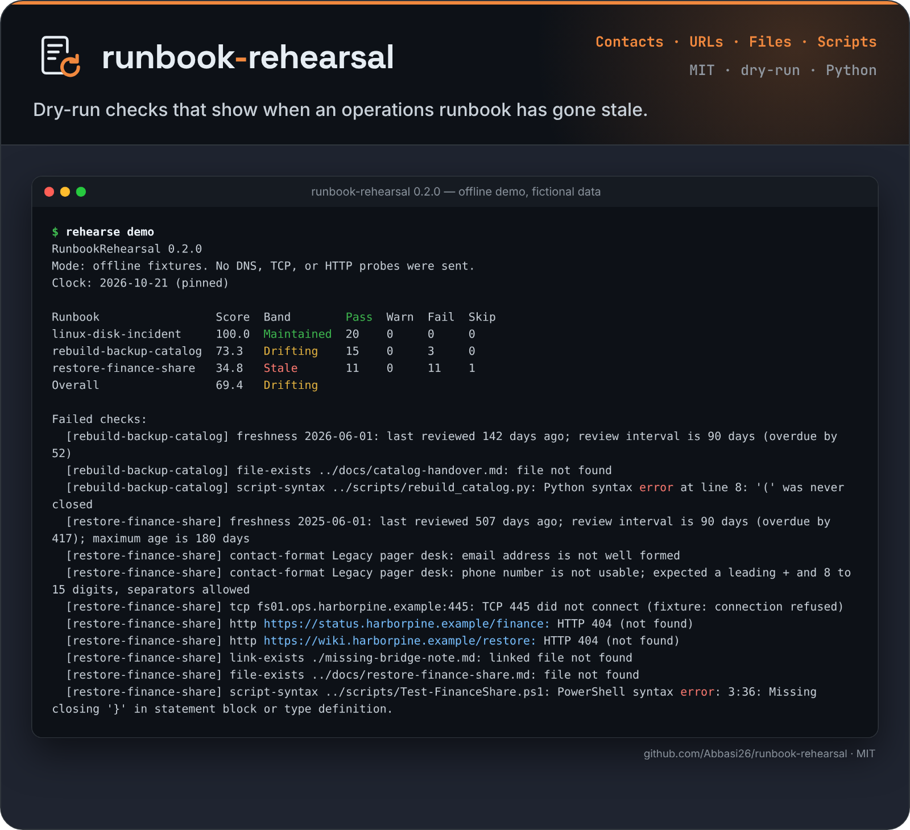

<p align="center">
  <picture>
    <source media="(prefers-color-scheme: dark)" srcset="docs/assets/logo-dark.svg">
    <source media="(prefers-color-scheme: light)" srcset="docs/assets/logo-light.svg">
    
  </picture>
</p>

<p align="center">Dry-run checks that show when an operations runbook has gone stale.</p>

<p align="center">
  
</p>

# RunbookRehearsal

[](https://github.com/Abbasi26/runbook-rehearsal/actions/workflows/ci.yml)

Dry-run checks that show when a written incident or operations runbook has gone stale.

People still keep the 03:00 procedure in a YAML or wiki page: who to call, which host to look at, which script to read, which share to restore. Those references rot quietly. RunbookRehearsal reads the YAML, checks the references, and writes a maturity report you can attach to a NIS2, ISO/IEC 27001, or BSI IT-Grundschutz conversation. The score is evidence of freshness and reference health. A certification decision stays with the operator and the auditor.

## The problem

Harbor and Pine is a fictional library cooperative. Its finance-share procedure was last reviewed on 1 June 2025. It still tells the on-call person to use `pager-desk` and the number `12345`, to open TCP 445 on `fs01.ops.harborpine.example`, to follow a restore note that is no longer in the folder, and to read `invoke-share.sh`, which does not parse. The status URL returns 404. The Active Directory group in the text is not in the directory list.

`rehearse demo` loads that procedure, plus a maintained Linux procedure and an overdue backup-catalog procedure, and prints the rot. The demo is offline. The hostnames are under `.example`, the addresses are the documentation range `203.0.113.0/24`, and the directory is a stub list in the config file. Nothing is probed and nothing is executed.

On a machine without `pwsh` the demo prints:

```text
Runbook                 Score  Band        Pass  Warn  Fail  Skip
linux-disk-incident     100.0  Maintained  20    0     0     0
rebuild-backup-catalog  71.7   Drifting    14    1     3     0
restore-finance-share   36.3   Stale       11    1     10    1
Overall                 69.3   Drifting
```

Failed checks on the finance procedure include the overdue review (507 days, past the 180-day maximum), the unusable pager contact, TCP 445 refused by the fixture, both status URLs at HTTP 404, the missing restore note, the bash syntax error in `invoke-share.sh`, and the finance admin group missing from the stub list. With `pwsh` on `PATH`, `Test-FinanceShare.ps1` is parsed with `Parser.ParseFile` and fails on the missing closing brace, and `Write-RehearsalNote.ps1` passes. Those two warnings become a failure and a pass. The scores become 34.8 Stale, 100.0 Maintained, and 73.3 Drifting, with an overall 69.4. The bands do not change.

## Quickstart

Python 3.11 or newer.

```bash
python -m pip install -e ".[dev]"
rehearse demo
```

That writes `rehearse-demo-out/report.html`, `report.md`, and `report.json` next to your shell and finishes well under a minute. The fixtures are in `examples/demo/`. Open the HTML file in a browser. It is a self-contained page with no network requests.

```bash
rehearse validate examples/demo/runbooks
rehearse check examples/demo/runbooks --config examples/demo/rehearse.yaml
```

`check` against the demo config stays offline because the config says `mode: offline`. `--live` would send real DNS queries for the `.example` names. Leave the demo on fixtures.

## Real usage

Put one YAML document per procedure in a directory. Point the editor at the schema:

```yaml
# yaml-language-server: $schema=../schema/runbook.schema.json
```

`examples/runbook.example.yaml` is a complete, valid document. `examples/vscode/settings.json` shows a workspace `yaml.schemas` entry for the Red Hat YAML extension. Copy it into `.vscode/settings.json` and adjust the path. `$schema` is a comment on purpose: it is not a field of the runbook.

A live config:

```yaml
mode: live
failUnder: 75
dueSoonDays: 14
timeouts:
  dnsSeconds: 3
  tcpSeconds: 3
  httpSeconds: 5
http:
  useEnvironmentProxy: false
directory:
  provider: none
```

```bash
rehearse check runbooks --config rehearse.yaml --output rehearse-out --fail-under 75
rehearse tabletop runbooks/restore-archive-share.yaml --participant "Sam Ortega"
rehearse tabletop runbooks/restore-archive-share.yaml --answers exercise.yaml --output tabletop-out
```

Exit codes for `check`:

| Code | Meaning |
| --- | --- |
| 0 | The files loaded, and the score is at or above `--fail-under` when that flag or `failUnder` is set. |
| 1 | The overall score is below the threshold, or `--strict` saw a failed finding. |
| 2 | A config error, a schema error, or no runbooks. Schema errors are reported and the other files are still checked. |

`rehearse demo` exits 0 when the fixtures load, including when their score is low. The rot is the point of the fixture.

`rehearse schema` prints the JSON Schema. `rehearse validate` checks shape only.

### Start a new runbook

```bash
rehearse init restore-erp --title "Restore the ERP database" --output runbooks/restore-erp.yaml
rehearse check runbooks/restore-erp.yaml --offline
```

`init` writes a skeleton that already passes `validate`: an owner, a contact, a precondition, two steps, and commented examples for each asset kind. Replace the placeholders. `--output -` prints it instead, and `--force` overwrites.

### What changed since the last run

```bash
rehearse diff last-week/report.json rehearse-out/report.json
rehearse diff last-week/report.json rehearse-out/report.json --format markdown > diff.md
rehearse check runbooks --config rehearse.yaml --output rehearse-out --baseline last-week/report.json --fail-on-regression
```

The diff lists score and band changes per runbook, findings that newly fail, findings that were fixed, and runbooks that were added or removed. A freshness finding is matched per runbook, so a new `lastReviewed` date shows up as fixed. `--fail-on-regression` exits 1 only when something got worse, which lets a team adopt the tool on old procedures and still stop new rot. With `--output`, `check --baseline` also writes `diff.md`. `examples/github-actions/rehearse-pull-request.yml` runs the base branch and the pull request offline and puts that Markdown in the job summary.

### What the document holds

`schema/runbook.schema.json` (draft 2020-12) requires `schemaVersion: "1.0"`, an id, title, summary, `execution: observe-only`, an owner, a service, a severity, a review block (`lastReviewed`, `intervalDays`, `maxAgeDays`), at least one contact, a precondition list, and at least one step. Steps have a description and an expected outcome. Assets are `host`, `url`, `group`, `file`, or `script`. Optional framework tags are `nis2`, `iso27001`, and `it-grundschutz`.

The schema checks shape. A stale date, a bad phone number, and a missing file are valid documents so the checker can report them. `execution` is fixed to `observe-only` so this file is not a job definition.

### Checks

All of them are non-destructive. v0.1 has no apply command and no remediation flag.

| Check | What it does |
| --- | --- |
| Freshness | Compares `lastReviewed` with the review interval and the maximum age. |
| Contacts | Checks email shape and, when a phone is present, a leading `+` and 8 to 15 digits. Spaces, dots, dashes, and parentheses are allowed. |
| DNS / TCP / HTTP | Resolves the host, connects to the TCP port if one is set, and requests the URL. |
| Files and links | Checks local paths relative to the runbook. Scans one level of Markdown and `href` links inside those files. |
| Script syntax | `python` via `compile()`, `bash` via `bash -n`, PowerShell via `pwsh` and `Parser.ParseFile`. |
| Groups | Looks up a group only when a directory provider is configured. |
| Completeness | A high or critical procedure needs a precondition. Each step needs an owner. |

Skip findings are listed and left out of the score. A missing `pwsh` or `bash` is a warning, not a pass.

Live HTTP sends `HEAD` with a one-byte `GET` when the server answers 405 or 501. TLS certificates are verified. Redirects stay on plain `http` and `https` URLs. `HTTP_PROXY` is ignored unless `http.useEnvironmentProxy` is true. URLs with embedded credentials are rejected at load time.

Offline mode answers only from `offline.hosts` and `offline.urls`. A target with no fixture fails. It does not fall through to the network. `clock.today` is honored only in offline mode, so a pinned date cannot hide a stale review in a live run. `rehearse demo` forces offline mode.

Directory providers:

| Provider | Behavior |
| --- | --- |
| `none` | Every group is a warning. The report says the group was not checked. |
| `stub` | Case-insensitive match against `directory.stub.groups`. For fixtures. The report says this is not Active Directory or Entra ID. |
| `ldap` | Read-only search through `ldap3`, installed with `pip install "runbookrehearsal[directory]"`. Password from `REHEARSE_LDAP_PASSWORD`. A DN is a base search. Any other value is a `cn` search under `baseDn`. |
| `graph` | `GET` to Microsoft Graph. Token from `REHEARSE_GRAPH_TOKEN`. A GUID selects the group id. Any other value is a `displayName` filter with quotes escaped. |

An asset marked `entra` is not queried through LDAP, and an asset marked `active_directory` is not queried through Graph. v0.1 tests the LDAP and Graph code with stand-in connections and HTTP responses. It has not been run against a production directory.

Script checks parse. They do not run the script. `bash -n` and `Parser.ParseFile` are syntax only, and `compile()` does not execute the code object.

### Score

Weights: freshness 20, contacts 15, reachability 25, references 20, directory 10, completeness 10.

A pass counts as 1, a warning as 0.5, a failure as 0. The dimension score is the mean of its scored findings. A dimension with only skips drops out and its weight is shared by the dimensions that remain. Each runbook score is rounded to one decimal, half up. The overall score is the equal-weight mean of those rounded scores, rounded the same way.

| Score | Band |
| --- | --- |
| 90–100 | Maintained |
| 75–89.9 | Usable with gaps |
| 50–74.9 | Drifting |
| 25–49.9 | Stale |
| 0–24.9 | Not rehearsable |

Freshness fails when `lastReviewed` is in the future, when the age is greater than `maxAgeDays`, or when the age is greater than `intervalDays`. The day the interval elapses is a warning when it falls inside `dueSoonDays` (default 14), not a failure. The failure starts the following day.

The JSON report repeats the weights, the per-dimension breakdown, every finding, and the SHA-256 of each runbook file. A CI job can read it:

```bash
jq -r '.runbooks[].findings[] | select(.status=="fail") | "\(.runbookId) \(.check) \(.target): \(.message)"' rehearse-out/report.json
```

### Tabletop

`rehearse tabletop` walks preconditions and steps in the terminal and stores the outcome (`met`, `not_met`, `partial`, `skipped`), the notes, the prompt answers, and the time spent on each step. From a terminal that time is the wall clock of the discussion. An answers file can supply `elapsedSeconds` for a transcribed exercise:

```yaml
participant: Sam Ortega
notes: Classroom exercise. No production changes.
preconditions:
  backup-fresh:
    outcome: met
    notes: Snapshot snap-2026-10-20 is listed.
steps:
  declare-incident:
    action: Posted in the incident channel and paged Priya.
    outcome: met
    elapsedSeconds: 240
    prompts:
      - prompt: What time did the commander acknowledge?
        response: "02:14 UTC"
```

The record is separate from the maturity score. It is what people said, not a test that the restore works. A non-interactive shell needs `--answers`.

### Scheduled check

`.github/workflows/ci.yml` runs the test suite, `rehearse demo`, and a diff smoke test on Python 3.11, 3.12, and 3.13. `examples/github-actions/rehearse-schedule.yml` is a weekly workflow you copy into the repository that holds your procedures. v0.1 is not on PyPI. The example installs the local checkout, or the git URL you set in the `RUNBOOKREHEARSAL_SPEC` repository variable. Map `REHEARSE_LDAP_PASSWORD` and `REHEARSE_GRAPH_TOKEN` from secrets only if the config actually selects `ldap` or `graph`. An empty secret is ignored.

### Reading the report as evidence

The HTML, Markdown, and JSON reports name these themes so a reviewer can file the artifact:

- NIS2 Directive (EU) 2022/2555, Article 21(2)(b) incident handling and 21(2)(c) business continuity and crisis management
- ISO/IEC 27001:2022 Annex A, A.5.24, A.5.25, A.5.26, A.5.29, A.5.30, and A.5.37
- BSI IT-Grundschutz-Kompendium, DER.2.1 Edition 2023 (A3, A9, A14) and DER.4 Edition 2022 (A1, A10, A14)

The compendium is under revision. Map the identifiers to the edition you were assessed against. The report states the limit next to each theme: a dry run shows that the written procedure and its references were checked. It does not show that a restore meets an RTO, that people answer the phone, or that a control is implemented.

## Required permissions

- Read the runbook files and the local files and scripts they name. v0.1 does not confine those paths to a root, and it follows symlinks. Run it on procedures you trust, as a user that should be allowed to read those paths.
- Live mode resolves DNS and opens a TCP connection and an HTTP request to every host and URL in the files. That is an active probe. It does not log in and it does not send an application payload beyond the HTTP request line and headers. Get permission before you point it at a network.
- LDAP needs a bind account that can search the group base. The password comes from `REHEARSE_LDAP_PASSWORD`. The tool binds read-only and does not write the password into the report.
- Microsoft Graph needs a token that can read group objects, in `REHEARSE_GRAPH_TOKEN`. v0.1 sends `GET` only. The token is redacted from error text.
- No admin rights, no service restarts, and no execution of the scripts named in the procedure.
- The tool does not phone home. Reports stay in the `--output` directory you name. `rehearse demo` writes `rehearse-demo-out/` in the current directory.

## How to contribute

See [CONTRIBUTING.md](CONTRIBUTING.md). Short version: English in code and docs, fictional data only, `pytest` from a checkout, and a test for any behavior you change. Please keep new checks non-destructive.

## Roadmap

[ROADMAP.md](ROADMAP.md) has the plan and a list of good first issues.

Not yet implemented:

- Third-party check plugins via entry points. The check classes in `rehearse.checks` are the extension point inside the tree.
- Authenticated HTTP, IPv6 host targets, and a content root that refuses paths outside a directory.
- A CI job that runs LDAP against a local directory container. The client is covered with a stand-in connection.
- Windows PowerShell 5.1. The parser we call is `pwsh` 7.
- Phone delivery checks and mailbox checks. Format is as far as v0.1 goes.

## How this differs from existing tools

This is a checker for the classic Windows and Linux operations runbook: the procedure a person follows. It is not an automation runner and it does not inject failure.

[Rundeck](https://docs.rundeck.com/docs/) and [PagerDuty Runbook Automation](https://www.pagerduty.com/platform/automation/runbook/) author and execute jobs on runners, with access control and an audit log of those executions. [PagerDuty Automation Actions](https://docs.pagerduty.com/ai-automation/automation/automation-actions) invokes those jobs from an incident. Rundeck's own tooling can validate a Rundeck job definition before import. That document is an executable job. RunbookRehearsal validates a different document and stops before anyone runs the steps.

[Backstage TechDocs](https://backstage.io/docs/features/techdocs/) publishes Markdown that lives with the code and can fail a docs build on structural problems. It does not track review age, escalation numbers, directory groups, or whether a PowerShell file still parses.

[Chaos Mesh](https://chaos-mesh.org/), [LitmusChaos](https://litmuschaos.io/), and [Gremlin](https://www.gremlin.com/) inject faults so you can see whether a system keeps its promise. RunbookRehearsal does not inject faults. In live mode the only packets it sends are DNS, a TCP handshake, and an HTTP request to targets the procedure already names.

[lychee](https://github.com/lycheeverse/lychee) finds broken links in documents. [ansible-lint](https://ansible.readthedocs.io/projects/lint/) checks Ansible content. Use them for those jobs. They will not notice that the after-hours number in a restore procedure belongs to a pager that was retired.

`rehearse tabletop` stores a local walkthrough. A commercial exercise platform or a cyber range is a different product: it simulates an incident for a team. This command asks the questions already written in the runbook and writes down the answers.

## Status

Version 0.2.0, early but usable. Python package with the CLI `rehearse`. MIT licensed. Every push runs the test suite in GitHub Actions (`.github/workflows/ci.yml`).

## Install

```sh
pip install .
```

## Tests

```sh
python -m pytest
```

## License

MIT. Copyright (c) 2026 Wasaf Abbasi. See [LICENSE](LICENSE), [SECURITY.md](SECURITY.md), and [CHANGELOG.md](CHANGELOG.md).

## Kurzfassung (Deutsch)

RunbookRehearsal prüft Einsatz- und Betriebsrunbooks, ohne die beschriebenen Schritte auszuführen. Die Verfahren liegen als YAML vor. Die Prüfungen sind absichtlich nicht destruktiv: Namensauflösung und Erreichbarkeit über DNS, TCP und HTTP, Syntax der genannten Skripte, Existenz lokaler Dateien und Links, Alter der letzten Review, Format von Kontakten und — nur wenn die Konfiguration es ausdrücklich einschaltet — ob eine Gruppe per LDAP oder Microsoft Graph noch vorhanden ist. `rehearse demo` zeigt das offline an erfundenen Runbooks der fiktiven Harbor and Pine Library Cooperative, ohne echte Infrastruktur.

Der Reifegradbericht als HTML, Markdown und JSON ist ein Nachweisstück für Gespräche zu NIS2, ISO/IEC 27001 und dem BSI IT-Grundschutz (Notfallhandbuch, Meldewege, Übungs- und Review-Nachweis). Die Bewertung, was der Bericht für eine Zertifizierung bedeutet, trifft die verantwortliche Stelle oder eine Prüforganisation. Ein hoher Punktwert bedeutet, dass die Referenzen frisch und in der gewählten Betriebsart erreichbar sind. Er bedeutet nicht, dass eine Wiederherstellung gelingt. `rehearse tabletop` geht das Runbook im Terminal durch und speichert Antworten und Zeiten lokal. Es gibt keine Telemetrie.
